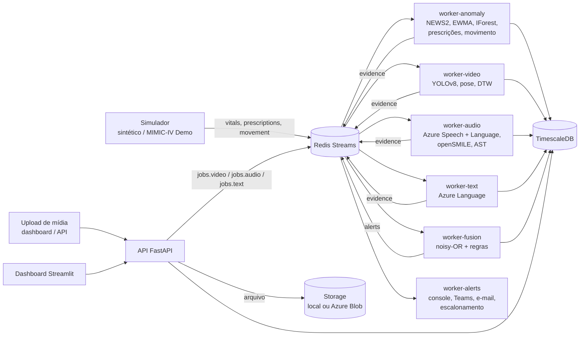

# MedWatch

Monitoramento multimodal de pacientes (Python + Azure AI) — Tech Challenge IADT Fase 4.

O MedWatch recebe **vídeo** (fisioterapia, leito, centro cirúrgico), **áudio** de consultas, **texto** (laudos),
**sinais vitais**, **prescrições** e **movimentação**. Cada modalidade gera *evidências* padronizadas; um motor de fusão
combina as evidências num **escore de risco (0–100)** por paciente e cria **alertas** (console, Teams, e-mail) que a equipe
confirma no dashboard.

- Arquitetura detalhada: [`docs/arquitetura.md`](docs/arquitetura.md)
- Relatório técnico: [`docs/relatorio-tecnico.md`](docs/relatorio-tecnico.md)
- Resultados medidos em dados reais: [`docs/resultados/datasets.md`](docs/resultados/datasets.md) · Dados: [`docs/DATASETS.md`](docs/DATASETS.md)
- Decisões de projeto: [`docs/DECISOES.md`](docs/DECISOES.md)
- Vídeo de demonstração: **[link a ser inserido após a publicação]**

> **Aviso de uso:** projeto acadêmico. Não é dispositivo médico, não substitui o julgamento clínico e deve usar apenas
> dados sintéticos, encenados ou públicos. Nunca envie dados reais de pacientes (LGPD).

## Arquitetura

Tudo roda com Docker Compose numa única máquina: uma imagem Python compartilhada pelos serviços, mais PostgreSQL com
TimescaleDB e Redis. Os serviços não se chamam entre si: cada um **lê de um fluxo do Redis (Streams)**, processa e
**escreve outro fluxo**, o que os mantém independentes e reiniciáveis.



**Fluxo:** cada modalidade gera *evidências* padronizadas (tipo, escore de 0 a 1, explicação em português). O
`worker-fusion` combina as evidências de um paciente num **risco de 0 a 100** e abre **alertas**; o `worker-alerts` os
entrega no console, no Teams e por e-mail, e escalona os que ninguém confirma. A equipe confirma no dashboard.

| Modalidade | Entrada | Técnicas e modelos |
|---|---|---|
| Sinais vitais | leituras por minuto | filtro fisiológico, escore **NEWS2**, **z-score EWMA** em streaming, **Isolation Forest** (não supervisionado) |
| Prescrições | eventos de prescrição | regras: interação medicamentosa, mudança de dose, medicamento de alta vigilância |
| Movimentação | contagem de atividade, presença no leito | regras: inatividade, agitação noturna, saída do leito |
| Áudio | consulta (WAV, MP3, M4A) | **Azure Speech** (transcrição e separação de falantes), **Azure Language** (sentimento, frases-chave, entidades de saúde), termos críticos, **openSMILE** (voz), **AST/AudioSet** (tosse e respiração) |
| Texto | laudos (`.txt`) | Azure Language e dicionário de termos críticos |
| Vídeo | fisioterapia, leito, cirurgia | **YOLOv8** (pose e objetos), ângulos articulares, **DTW**, regressão logística (agachamento), regras de queda |

**Fusão:** `risco = 1 − Π(1 − peso × escore × exp(−Δt/15 min))` (*noisy-OR* com decaimento no tempo), regras
multimodais que multiplicam o risco quando duas modalidades concordam, e um piso crítico para queda e NEWS2 alto. Pesos e
limiares ficam em [`config/`](config/). Detalhes, streams, tabelas e catálogo de evidências em
[`docs/arquitetura.md`](docs/arquitetura.md).

## Requisitos

| Item | Requisito |
|---|---|
| Docker | Docker Desktop 4.30+ (Windows/macOS) ou Docker Engine 26+ (Linux), com **Compose v2** (`docker compose`) |
| Windows | Backend WSL 2 ativado no Docker Desktop |
| Memória para o Docker | Mínimo 8 GB, recomendado 10–12 GB. No Windows, em `%UserProfile%\.wslconfig`: `[wsl2]` e `memory=10GB`, depois `wsl --shutdown` |
| Disco | ~15 GB (imagem ~5 GB com Torch CPU, modelos ~0,5 GB, banco e mídias) |
| Rede | PyPI, download.pytorch.org, Docker Hub, GitHub (pesos YOLO) e Hugging Face (modelo AST) no primeiro build/execução |
| GPU (opcional) | NVIDIA com driver recente (CUDA no WSL 2 / NVIDIA Container Toolkit); use `docker-compose.gpu.yml` |
| Azure (opcional) | Speech e Language reais. Sem chaves, use `USE_FAKE_AZURE=true` |

## Passo a passo (Docker)

Os comandos `docker` são iguais no PowerShell e no bash. Só a cópia do `.env` muda.

1. Criar o `.env` (preencha as chaves Azure ou defina `USE_FAKE_AZURE=true`):

   ```bash
   cp .env.example .env
   ```
   ```powershell
   Copy-Item .env.example .env
   ```
2. Construir a imagem (o primeiro build leva de 10 a 20 minutos):

   ```bash
   docker compose build
   ```
3. Subir tudo (o `models-init` baixa os modelos e termina; os workers de áudio e vídeo esperam por ele):

   ```bash
   docker compose up -d
   ```
4. Conferir o estado:

   ```bash
   docker compose ps
   ```
5. Criar os pacientes de demonstração:

   ```bash
   docker compose run --rm api python scripts/seed.py
   ```
6. Treinar o Isolation Forest e reiniciar o worker que o carrega:

   ```bash
   docker compose run --rm api python scripts/train_vitals_iforest.py
   docker compose restart worker-anomaly
   ```
7. Iniciar o simulador da demo:

   ```bash
   docker compose --profile demo up simulator
   ```
8. Abrir o dashboard em <http://localhost:8501> e a documentação da API em <http://localhost:8000/docs>.

Modo desenvolvimento (código montado e reload automático):

```bash
docker compose -f docker-compose.yml -f docker-compose.dev.yml up -d
```

### Demonstração completa com mídias

O `run_demo.py` roda no seu ambiente Python (veja "Instalação local" abaixo; para ele basta `pip install -e ".[dev]"`),
fala com a API em `localhost` e envia as mídias de exemplo nos minutos certos do cenário. Coloque as amostras em
`data/samples/` (veja [`data/samples/README.md`](data/samples/README.md)) e, com o Compose no ar e os passos 5 e 6 feitos:

```bash
python scripts/run_demo.py                       # inicia o simulador como subprocesso
python scripts/run_demo.py --external-simulator  # e, em outro terminal: docker compose --profile demo up simulator
```

Para ver só o trecho útil (minutos 360–480 em cerca de 10 minutos reais), acrescente `--fast-until 355 --tail-speedup 12`.
Antes, rode a checagem prévia, que lista com ✓/✗ o que falta (API, workers, Azure, Teams/e-mail, amostras, modelos e banco limpo):

```bash
docker compose run --rm api python scripts/preflight_demo.py [--send-test]
```

## Instalação local (sem Docker)

```bash
python -m venv .venv && source .venv/bin/activate        # PowerShell: .venv\Scripts\Activate.ps1
pip install torch torchvision --index-url https://download.pytorch.org/whl/cpu
pip install -e ".[audio,video,reports,dashboard,dev]"
```

Fora do Docker use `localhost` para banco e Redis (como no `.env.example`); suba `db` e `redis` com o Compose.

## Testes

```bash
pytest -q && ruff check .                      # local
docker compose run --rm api pytest -q          # no container
```

Os testes usam fakeredis, `USE_FAKE_AZURE` e modelos falsos; alguns precisam do banco do Compose (`db`).

## Integração com a Azure

Sem chaves, use `USE_FAKE_AZURE=true` no `.env`: clientes falsos, offline (é o modo dos testes). Para usar os serviços
reais, são três recursos: **Azure Speech** (transcrição e separação de falantes), **Azure AI Language** (sentimento,
frases-chave, entidades de saúde) e **Blob Storage** (opcional; sem ele o sistema guarda os arquivos em disco).

**1. Criar os recursos** (precisa do [Azure CLI](https://learn.microsoft.com/cli/azure/install-azure-cli), de uma assinatura
ativa e de `az login`; no Windows rode o script pelo Git Bash):

```bash
az login
bash scripts/provision_azure.sh > azure.env   # cria o grupo de recursos, Speech, Language e Storage; a saída são só as variáveis
```

Variáveis opcionais do script: `SUFFIX`, `RG` (padrão `rg-medwatch`), `LOC` (padrão `brazilsouth`). Alternativa sem CLI:
crie os recursos pelo portal e copie as chaves e o endpoint.

**2. Passar as chaves ao `.env`** (nunca commite o `.env`) e **recriar os serviços** para eles lerem as novas variáveis:

```bash
cat azure.env >> .env                                  # PowerShell: Get-Content azure.env | Add-Content .env
```

No `.env`, confirme `USE_FAKE_AZURE=false` e que `AZURE_SPEECH_KEY`, `AZURE_SPEECH_REGION`, `AZURE_LANGUAGE_KEY` e
`AZURE_LANGUAGE_ENDPOINT` estão preenchidos. Para guardar mídias no Blob, defina também `STORAGE_BACKEND=azure`. Depois:

```bash
docker compose up -d
```

**3. Verificar** (Speech e Language; o Storage só é testado com `STORAGE_BACKEND=azure`):

```bash
docker compose run --rm api python scripts/synthesize_consulta.py --only hello   # gera data/samples/hello_ptbr.wav com a própria Azure
docker compose run --rm api python scripts/check_azure.py
```

O `check_azure.py` termina com código 0 se tudo responde (saída esperada: `[speech] OK`, `[language] OK` e `Tudo OK`). A transcrição só é testada se existir `data/samples/hello_ptbr.wav`.

**4. Ver a Azure em ação** (toca o áudio e mostra a transcrição aparecendo em paralelo; roda no ambiente local com
`pip install -e ".[audio,dev]"`):

```bash
python scripts/demo_azure_live.py data/samples/consulta_p0001.wav --language
```

Observações: se o recurso Language pedir aceite de termos de IA responsável, crie-o uma vez pelo portal; se algum recurso
(ex.: entidades de saúde) não existir em `brazilsouth`, use `LOC=eastus`; as SKUs gratuitas (`F0`) servem, com limites
menores; crie um alerta de orçamento no portal. Use somente dados sintéticos, encenados ou públicos.

### Alertas no Teams e por e-mail

Sem estas variáveis os alertas saem só no console e no dashboard. Para os canais externos:

- **Teams:** no canal desejado, *Workflows* → modelo "Post to a channel when a webhook request is received" → copie a URL
  para `TEAMS_WEBHOOK_URL`.
- **E-mail:** crie uma Logic App (Consumption) com o gatilho "When a HTTP request is received" (esquema JSON
  `{"to": "", "subject": "", "html": ""}`) e a ação "Send an email (V2)" do Outlook, com `to`, `subject` e `html` vindos do
  gatilho. Copie a URL do gatilho para `LOGIC_APP_EMAIL_URL` e o destinatário para `ALERT_EMAIL_TO`.

Depois de editar o `.env`, rode `docker compose up -d`. Para enviar uma mensagem de teste aos dois canais:
`docker compose run --rm api python scripts/preflight_demo.py --send-test`.

## Avaliação e limitações

Cada dataset tem três partes: **calibração** e **validação** ajustam limiares e modelos, e o **reservado** nunca ajusta
nada e é medido uma vez (as divisões estão em [`config/splits.yaml`](config/splits.yaml)). Os resultados, com intervalos de
confiança, estão em [`docs/resultados/datasets.md`](docs/resultados/datasets.md) e os dados e licenças em
[`docs/DATASETS.md`](docs/DATASETS.md). Datasets usados: MIMIC-IV Demo, ESC-50, Common Voice, UR Fall, CAUCAFall,
REHAB24-6 e Keraal. Os arquivos baixados e os modelos treinados ficam em `data/` e `models/`, fora do Git.

Limites conhecidos, medidos: a detecção de queda depende do ponto de vista da câmera (26 de 30 quedas no UR Fall, 12 de 50
no CAUCAFall); na fisioterapia o modelo do agachamento separa bem as repetições (AUC 0,85 no reservado), mas o tipo de erro
no Keraal não é distinguível com 17 pontos em 2D; a análise de voz só mede falsos alarmes; a análise de cirurgia usa
regras sobre o detector genérico e não foi medida com dados reais. Detalhes em
[`docs/relatorio-tecnico.md`](docs/relatorio-tecnico.md).

> O modelo do agachamento (`models/physio_squat.joblib`) é gerado por `scripts/train_physio_model.py --save` a partir do
> REHAB24-6 e do Keraal (veja `docs/DATASETS.md`). Sem esse arquivo o agachamento volta às regras fixas.

## Comandos do dia a dia

| Objetivo | Comando |
|---|---|
| Logs de um serviço | `docker compose logs -f worker-fusion` |
| Shell na imagem | `docker compose run --rm api bash` |
| Consultar o banco | `docker compose exec db psql -U medwatch -d medwatch -c "select count(*) from evidence"` |
| Tamanho de um stream | `docker compose exec redis redis-cli XLEN evidence` |
| Mensagens pendentes | `docker compose exec redis redis-cli XPENDING evidence worker-fusion` |
| Parar (mantém dados) | `docker compose down` |
| Apagar banco, streams e caches | `docker compose down -v` |

## Problemas comuns

| Sintoma | Causa provável | Solução |
|---|---|---|
| `Bind for 0.0.0.0:5432 failed: port is already allocated` | Postgres local usando a porta | Mude `DB_PORT` no `.env` (ex.: `5433`); vale também para `REDIS_PORT`, `API_PORT`, `DASHBOARD_PORT` |
| Tabelas não existem | `pgdata` já existia quando o `init.sql` mudou | `docker compose down -v` e subir de novo |
| `env file .env not found` | `.env` não foi criado | Passo 1 |
| Container encerrado com código 137 | Falta de memória (YOLO, AST, Torch) | Aumentar a memória do WSL 2/Docker Desktop; `AUDIO_DISABLE_EVENTS=true`; `VIDEO_TARGET_FPS=5` |
| `bash\r: No such file or directory` | Script com CRLF | `.gitattributes` do repositório e `git add --renormalize .` |
| `models-init` termina com código 1 | Sem acesso a GitHub ou Hugging Face | Verificar rede/proxy e `docker compose up models-init` de novo |
| `could not translate host name "db"` fora do Docker | `.env` com host do Docker | Fora do Docker use `localhost`, como no `.env.example` |
| `pyarrow`/openSMILE não importam | pyarrow 26 exige NumPy 2 | `pip install "pyarrow<18"` |
| Build muito lento ou enorme | `.dockerignore` ausente | Restaurar o `.dockerignore` |
| `pip`: `CERTIFICATE_VERIFY_FAILED ... self-signed certificate in certificate chain` (Windows) | Antivírus (ex.: Kaspersky) intercepta o HTTPS com um certificado próprio que o Python não conhece | Não use `--trusted-host`. Exporte a raiz do antivírus do repositório de certificados do Windows, junte-a ao pacote de certificados do `pip` e aponte `PIP_CERT` para o arquivo. Dentro do Docker o problema não ocorre |
| `OSError: [WinError 4551] ... Controle de Aplicativo bloqueou este arquivo ... torch\lib\shm.dll` | Política do Windows (App Control / Smart App Control) bloqueia as DLLs do Torch | Rode os testes e o stack **dentro do Docker** (`docker compose run --rm api pytest -q`) |
| Torch com GPU: `no kernel image is available for execution on the device` | Placa RTX 50xx (Blackwell) precisa de CUDA 12.8+; o índice `cu121` não serve | `TORCH_INDEX_URL=https://download.pytorch.org/whl/cu128`, `docker compose build` e suba com `-f docker-compose.yml -f docker-compose.gpu.yml`. Com os modelos YOLO "nano" a GPU não é mais rápida que a CPU |
| Workers reiniciando em loop com `redis.exceptions.TimeoutError: Timeout reading from socket` | redis-py 8 com `socket_timeout` menor ou igual ao `block_ms` do `XREADGROUP` | Corrigido em `medwatch.bus.SOCKET_TIMEOUT_S`; atualize o código e reinicie os workers |

## Estrutura de pastas

```
config/        limiares, pesos de fusão, exercícios, termos críticos (YAML)
db/            init.sql (TimescaleDB)
docs/          arquitetura, relatório técnico, decisões, resultados da avaliação
scripts/       seed, treino do Isolation Forest, avaliação, demo, Azure, modelos
src/medwatch/
  api/         FastAPI (pacientes, mídia, alertas, relatórios)
  simulator/   dados sintéticos e replay do MIMIC-IV Demo
  anomaly/     NEWS2, EWMA z-score, Isolation Forest, prescrições, movimentação
  audio/       Azure Speech, Azure Language, features acústicas, sons respiratórios
  text/        worker de documentos
  video/       YOLO, pose, DTW, fisioterapia, leito, cirurgia, vídeo anotado
  fusion/      motor de fusão e worker
  alerts/      canais (console, Teams, e-mail) e escalonamento
  reports/     relatórios HTML/PDF
  dashboard/   Streamlit
tests/         testes automatizados
data/, models/ amostras e modelos (fora do Git)
```
