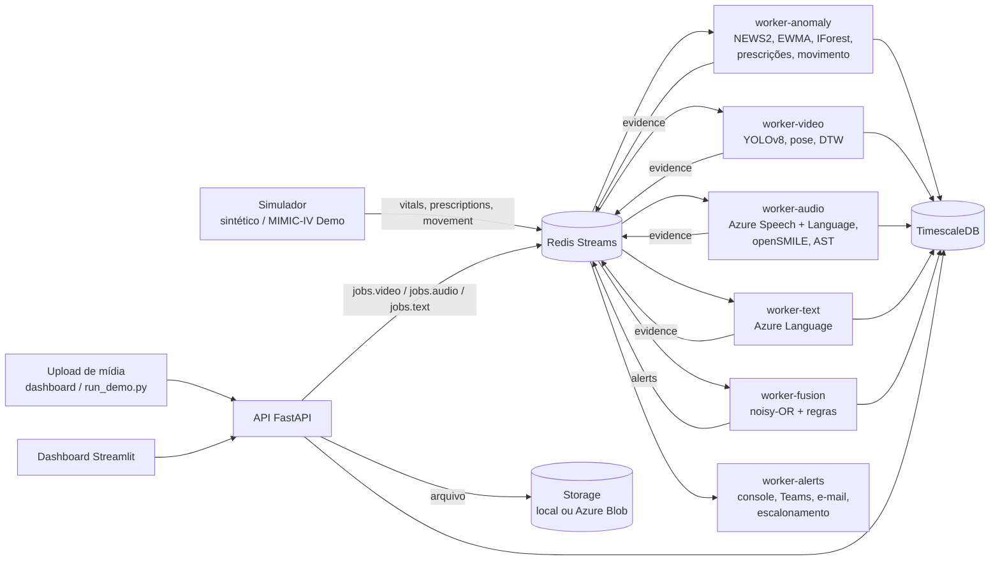

# Arquitetura do MedWatch

Todo o sistema roda com Docker Compose numa única máquina: uma imagem Python (`medwatch-app`) compartilhada pelos
serviços da aplicação, mais PostgreSQL/TimescaleDB e Redis. Os serviços se comunicam por **Redis Streams** e gravam o
estado no banco.

## Diagrama

## Serviços

| Serviço | Comando | Função |
|---|---|---|
| `db` | `timescale/timescaledb:latest-pg16` | Banco relacional + hypertables (`vitals`, `movement`, `risk_snapshots`) |
| `redis` | `redis:7-alpine` (AOF) | Streams entre os serviços |
| `models-init` | `scripts/download_models.py` | Baixa pesos YOLO e AST uma vez e termina |
| `api` | `uvicorn medwatch.api.main:app` | Pacientes, upload de mídia/documentos, leitura e confirmação de alertas, relatórios |
| `worker-anomaly` | `medwatch.anomaly.worker` | Vitais (filtro fisiológico, NEWS2, EWMA z-score, Isolation Forest), prescrições, movimentação |
| `worker-video` | `medwatch.video.worker` | Fisioterapia, leito, cirurgia; gera vídeo anotado, frames-chave e relatório |
| `worker-audio` | `medwatch.audio.worker` | Conversão, transcrição, termos críticos, entidades, voz, sons respiratórios |
| `worker-text` | `medwatch.text.worker` | Laudos em texto: termos críticos e entidades clínicas |
| `worker-fusion` | `medwatch.fusion.worker` | Combina evidências, escore de risco, cria/escalona alertas |
| `worker-alerts` | `medwatch.alerts.worker` | Entrega nos canais e escalonamento por falta de confirmação |
| `dashboard` | Streamlit | Painel, paciente, alertas, upload |
| `simulator` | `medwatch.simulator.replay` | Replay de sinais (profile `demo`) |

Portas no host (presas a `127.0.0.1`): banco `DB_PORT` (5432), Redis `REDIS_PORT` (6379), API `API_PORT` (8000),
dashboard `DASHBOARD_PORT` (8501).

## Streams

| Stream | Produtor | Consumidor | Conteúdo |
|---|---|---|---|
| `vitals` | simulador | worker-anomaly | `VitalObservation` |
| `prescriptions` | simulador | worker-anomaly | `PrescriptionEvent` |
| `movement` | simulador, worker-video | worker-anomaly | `MovementSample` |
| `jobs.video` | API | worker-video | job de mídia (vídeo) |
| `jobs.audio` | API | worker-audio | job de mídia (áudio) |
| `jobs.text` | API | worker-text | job de mídia (documento) |
| `evidence` | anomaly, video, audio, text | worker-fusion | `Evidence` |
| `alerts` | worker-fusion | worker-alerts | alerta criado/escalonado |

Cada consumidor usa um *consumer group*; a mensagem só recebe ACK depois de processada, e mensagens com erro ficam
pendentes (`XPENDING`).

## Tabelas

| Tabela | Conteúdo |
|---|---|
| `patients` | Pacientes e leitos |
| `media` | Mídias enviadas: tipo, modo, status (`queued/processing/done/failed`), artefatos (JSONB) |
| `vitals` (hypertable) | Sinais vitais e NEWS2 |
| `prescriptions` | Eventos de prescrição (`start/change/stop`) com nome normalizado |
| `movement` (hypertable) | Contagem de atividade e presença no leito |
| `transcripts` | Segmentos transcritos e análise de linguagem por mídia |
| `evidence` | Evidências de todas as modalidades (seção abaixo) |
| `alerts` | Alertas: nível, escore, evidências, status, escalonamento, confirmação |
| `risk_snapshots` (hypertable) | Série do escore de risco com as 10 maiores contribuições |

## Contrato de evidência

Toda saída de modelo vira uma `Evidence`: `evidence_id`, `patient_id`, `modality`
(`video|audio|text|vitals|prescription|movement`), `type`, `score` (0–1), `severity` (`info|warning|critical`),
`ts_start`, `ts_end`, `explanation` (pt-BR), `source_ref` (ex.: `media:<uuid>#t=130`), `model_name`, `model_version` e
`payload`. Quando não há score natural: 0,5 (warning), 0,8 (critical), 0,3 (info).

## Catálogo de evidências

Pesos padrão em `config/fusion.yaml`.

| type | modality | produtor | severidade típica | peso | payload |
|---|---|---|---|---|---|
| `news2_low_medium` | vitals | anomaly | warning | 0.45 | `{news2, params}` |
| `news2_medium` | vitals | anomaly | warning | 0.65 | `{news2, params}` |
| `news2_high` | vitals | anomaly | critical | 0.95 | `{news2, params}` |
| `vital_zscore` | vitals | anomaly | warning | 0.40 | `{vital, value, z}` |
| `vital_iforest` | vitals | anomaly | warning | 0.50 | `{iforest_score, features}` |
| `rx_dose_change` | prescription | anomaly | warning | 0.40 | `{drug, old_dose, new_dose, ratio}` |
| `rx_high_alert_start` | prescription | anomaly | info | 0.35 | `{drug}` |
| `rx_interaction` | prescription | anomaly | warning | 0.60 | `{drugs, note}` |
| `rx_duplicate_class` | prescription | anomaly | info | 0.30 | `{drug_class, drugs}` |
| `rx_change_burst` | prescription | anomaly | warning | 0.40 | `{changes_24h}` |
| `movement_inactivity` | movement | anomaly | warning | 0.35 | `{minutes}` |
| `movement_night_agitation` | movement | anomaly | warning | 0.40 | `{activity, threshold}` |
| `movement_bed_exit` | movement | anomaly | warning | 0.50 | `{}` |
| `fall_detected` | video | video | critical | 0.95 | `{t_video_s, frame_key}` |
| `bed_exit_video` | video | video | warning | 0.50 | `{t_video_s}` |
| `physio_low_rom` | video | video | info | 0.25 | `{joint, rom, ref_rom, rep}` |
| `physio_asymmetry` | video | video | info | 0.25 | `{joint_pair, diff_deg, rep}` |
| `physio_pattern_deviation` | video | video | info | 0.30 | `{dtw, threshold, rep}` |
| `physio_trunk_compensation` | video | video | info | 0.20 | `{trunk_deg, rep}` |
| `surgery_zone_intrusion` | video | video | warning | 0.50 | `{zone, people, max}` |
| `surgery_instrument_out_of_zone` | video | video | warning | 0.40 | `{cls, seconds}` |
| `surgery_instrument_count_mismatch` | video | video | critical | 0.70 | `{start_count, end_count}` |
| `speech_critical_term` | audio | audio | warning | 0.50 | `{term, category, segment_index}` |
| `speech_negative_sentiment` | audio | audio | info | 0.20 | `{negative_ratio}` |
| `voice_fatigue` | audio | audio | warning | 0.35 | `{features, flags}` |
| `voice_dysarthria_indicator` | audio | audio | warning | 0.45 | `{features, flags}` |
| `respiratory_sound` | audio | audio | warning | 0.45 | `{label, max_score, windows}` |
| `clinical_entity` | audio/text | audio, text | info | 0.10 | `{entities}` |
| `text_critical_term` | text | text | warning | 0.45 | `{term, category}` |

## Motor de fusão

1. Cada evidência contribui com `peso × score × exp(−Δt/τ)` (τ = 15 min; janela de 360 min, em tempo do evento).
2. Só a maior contribuição por `type` entra no cálculo.
3. Combinação **noisy-OR**: `risco = 1 − Π(1 − contribuição)`.
4. Regras multimodais (ex.: queda com sedativo recente, sinais neurológicos em voz e movimento) multiplicam o risco (×1,4).
5. Escore 0–100 e níveis: crítico ≥ 70, atenção ≥ 40, info ≥ 20. Tipos em `floor_critical` mantêm o nível crítico enquanto recentes.

O worker de fusão grava a evidência, atualiza `risk_snapshots`, cria o alerta (com cooldown), escalona quando o nível
sobe e publica em `alerts`. O worker de alertas entrega por console, Teams e e-mail e escalona alertas sem confirmação
(`ALERT_ESCALATION_MINUTES`).
