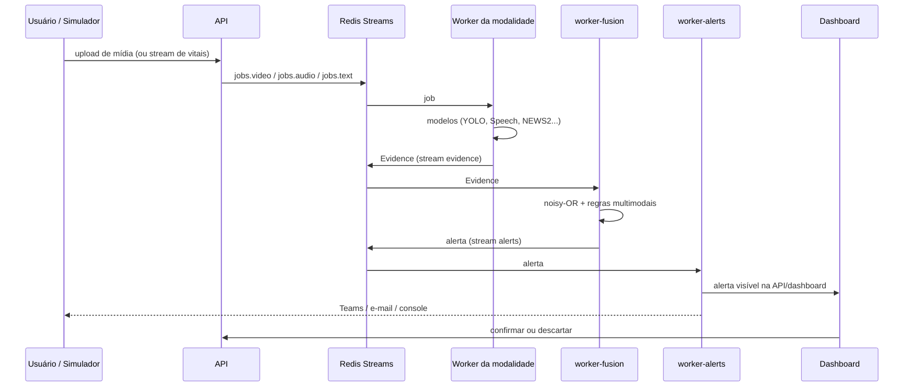

# MedWatch — Relatório técnico

Tech Challenge IADT, Fase 4: monitoramento multimodal de pacientes com Python e Azure AI.

> Itens marcados **[PENDENTE]** dependem de passos humanos (chaves Azure, gravações, prints) e não foram verificados.

## 1. Introdução e objetivo

Equipes clínicas recebem informação dispersa: sinais vitais num sistema, prescrições noutro, vídeos de fisioterapia ou
de leito sem análise, consultas gravadas e laudos em texto. O MedWatch integra essas fontes num fluxo único. Cada
modalidade é analisada por modelos específicos e produz **evidências** padronizadas e explicáveis; um motor de fusão
transforma o conjunto num **escore de risco por paciente** e dispara **alertas** que a equipe confirma ou descarta.

Objetivos: (a) cobrir vídeo, áudio, texto e séries temporais; (b) usar serviços Azure AI onde há ganho (fala e
linguagem); (c) manter cada alerta rastreável até a mídia/medida de origem; (d) rodar de forma reprodutível com Docker Compose.

O sistema é um protótipo acadêmico, não um dispositivo médico.

## 2. Descrição do fluxo multimodal

Diagrama completo, serviços, streams e tabelas: [`arquitetura.md`](arquitetura.md).

**Sequência de um alerta (exemplo).** Um áudio de consulta é enviado para o paciente P-0001: o worker de áudio converte
para WAV 16 kHz, transcreve com Azure Speech, procura termos críticos (ex.: "falta de ar") e detecta tosse. Publica
`speech_critical_term` e `respiratory_sound`. Se o paciente já tem `news2_medium` recente, o worker de fusão aplica o
noisy-OR e a regra *respiratorio_multimodal* (×1,4), o escore cruza 70 e um alerta crítico é criado, com título e resumo
em português apontando as evidências. O worker de alertas notifica e, se ninguém confirmar em
`ALERT_ESCALATION_MINUTES`, escalona.

**Contrato de evidências.** Toda saída vira uma `Evidence` com `type` do catálogo (29 tipos, `arquitetura.md`), `score`
0–1, `severity`, intervalo de tempo, `explanation` em pt-BR, `source_ref` (ex.: `media:<uuid>#t=130`), `model_name`,
`model_version` e `payload`. O contrato desacopla os produtores da fusão: um novo modelo só precisa emitir evidências.

## 3. Modelos aplicados por tipo de dado

| Modalidade | Modelo / serviço | Entrada | Saída | Motivo da escolha | Limitações |
|---|---|---|---|---|---|
| Vídeo (objetos) | YOLOv8n (COCO) | frames | caixas e classes | leve, roda em CPU, pesos públicos | COCO só conhece objetos genéricos: instrumentos cirúrgicos reais não são reconhecidos; a análise de cirurgia é demonstrativa |
| Vídeo (pose) | YOLOv8n-pose | frames | 17 keypoints | mesmo runtime do detector, sem dependências extras | precisão da pose não medida contra captura de movimento (a comparação com o OpenPose não foi feita; T19b/T34 não implementadas); no REHAB24-6 a pose bastou para contar repetições (erro médio de 1,8 por bloco), não para separar repetições corretas das incorretas |
| Fisioterapia | Ângulos articulares + contagem de repetições + **DTW** contra referência | keypoints | ROM, assimetria, desvio de padrão, compensação de tronco | DTW compara a forma do movimento sem depender da velocidade; referência gerada de um vídeo correto | depende de câmera lateral e corpo inteiro; referência real exige gravação **[PENDENTE]** |
| Leito | Regras sobre pose/posição do tronco | keypoints | queda, saída do leito | simples e explicável | sem validação em vídeo de queda real **[PENDENTE]**; ângulo de câmera sensível |
| Fala | **Azure Speech** (pt-BR) | WAV 16 kHz | transcrição por segmentos | qualidade e suporte a pt-BR sem treinar modelo | custo por hora de áudio; requer chaves **[PENDENTE]**; há cliente falso para testes |
| Linguagem | **Azure AI Language** + dicionário de termos críticos | transcrição / laudo | sentimento, entidades clínicas | entidades de saúde prontas; dicionário cobre termos críticos em pt-BR | entidades de saúde dependem da região; dicionário é lista fechada |
| Voz | **openSMILE** (eGeMAPS) + pausas/velocidade | áudio | indicadores de fadiga e disartria vs. linha de base | features acústicas interpretáveis | precisa de linha de base individual; no ambiente de desenvolvimento o openSMILE não importou (pyarrow x NumPy), então só pausa/velocidade foram exercitadas |
| Sons respiratórios | **AST** (`MIT/ast-finetuned-audioset-10-10-0.4593`) | janelas de áudio | tosse, espirro etc. com score | modelo treinado no AudioSet, sem treino próprio | ~350 MB; só eventos de classe respiratória com score ≥ 0,6 viram evidência; teste com modelo real não executado |
| Vitais (regra) | **NEWS2** + filtro fisiológico | FC, PA, SpO₂, FR, T, consciência, O₂ | escore 0–20 e evidências | padrão clínico conhecido e explicável | não substitui avaliação clínica; filtro descarta valores impossíveis (artefato de sensor) |
| Vitais (estatística) | **EWMA z-score** em streaming | série de cada sinal | desvio relativo ao próprio paciente | adapta-se a cada paciente, custo constante | limiar 3,0 gera falsos positivos em séries de baixa variância |
| Vitais (ML) | **Isolation Forest** | janela de features por minuto | score de anomalia | não supervisionado, não exige rótulos | treinado em dados sintéticos; `--mimic` não testado; muitos falsos positivos |
| Prescrições | Regras + `config/drugs.yaml` | eventos de prescrição | mudança de dose, medicamento de alta vigilância, interação, classe duplicada, rajada | explicável, baseado em listas curadas | lista pequena e não clínica; não cobre todas as interações |
| Movimentação | Regras sobre contagem de atividade | `MovementSample` | inatividade, agitação noturna, saída do leito | simples | noite definida em UTC na demo |
| Fusão | **noisy-OR** com decaimento exponencial e regras multimodais | evidências | risco 0–100, nível, contribuições | probabilístico, monotônico, cada contribuição explicável | pesos definidos por julgamento, não calibrados com desfechos reais |

## 4. Integração com a Azure

| Recurso | Uso | Observações |
|---|---|---|
| Azure AI Speech | transcrição pt-BR no worker de áudio | região padrão `brazilsouth` |
| Azure AI Language | sentimento e entidades clínicas | se a região não oferecer saúde, usar `eastus` com dados sintéticos |
| Azure Blob Storage | armazenamento de mídias e artefatos (opcional; padrão `local`) | `STORAGE_BACKEND=azure` |
| Logic App / Teams | alertas por e-mail e canal (opcional) | webhooks pelo `.env` |

O provisionamento é feito por `scripts/provision_azure.sh` (grupo `rg-medwatch`) e a verificação por
`scripts/check_azure.py`. Com `USE_FAKE_AZURE=true` todo o fluxo roda offline com clientes falsos.

- **Execução real:** feita em 2026-11-10 na assinatura POSTECH (região `brazilsouth`): Speech, Language (inclusive entidades
  de saúde em português) e Blob responderam, e uma consulta sintética de 38 s passou pelo pipeline completo, com separação de
  falantes correta. Detalhes, a transcrição e as limitações (erro de reconhecimento que gerou um termo crítico falso) estão
  em `docs/resultados/azure_integracao.md`.
- **Custos observados:** **[PENDENTE]** — ler no portal (Cost Management) depois da demo; o consumo até aqui foi de poucos
  minutos de áudio e algumas chamadas (Speech cobra por hora de áudio; Language por 1.000 registros).
- **Prints do portal:** **[PENDENTE]** — recursos criados, métricas de uso e orçamento.

## 5. Resultados obtidos

### 5.1 Sinais vitais (dados sintéticos)

Avaliação com `scripts/evaluate_vitals.py`: 30 pacientes sintéticos (seeds 100–129), 24 h cada, 15 episódios rotulados
(deterioração respiratória, hipotensão, taquicardia) e 10 pacientes normais. A T36 trocou o método da T31, que dava
precisão de 1% a 3%, por dois motivos: (1) no gerador a piora continuava até o fim do dia, mas o rótulo terminava no fim
da rampa, então cada repetição do NEWS2 com o paciente ainda grave contava como falso positivo (agora os rótulos de
`respiratory_deterioration` e `hypotension` vão até o fim da série); (2) contar cada evidência como um erro não mede o
que a equipe médica recebe. Passaram a existir três métricas: por evidência (a antiga), por episódio (detecções do mesmo
tipo com menos de 30 min entre si formam um episódio) e **por alerta** (evidências passadas pelo motor de fusão; o
alerta abre em nível `warning` ou mais e fecha com risco < 20 por 60 min). O número principal é o do alerta.

Limiares escolhidos numa grade de 24 combinações (`docs/resultados/vitals_tuning.md`): z-score 3,0 com persistência 1;
Isolation Forest no percentil 0,1 com persistência 3.

**Por alerta (seeds 100–129)**

| Configuração | TP | FP | FN | Precisão | Recall | Atraso mediano (min) | Alertas/dia em normais |
|---|---|---|---|---|---|---|---|
| NEWS2 | 6 | 1 | 9 | 0,86 | 0,40 | 40,0 | 0,00 |
| NEWS2 + z-score | 13 | 3 | 2 | 0,81 | 0,87 | 37,0 | 0,10 |
| NEWS2 + z-score + IForest | 14 | 3 | 1 | 0,82 | 0,93 | 30,5 | 0,10 |

**Antes × depois (NEWS2 + z-score + IForest)**

| Método | Precisão | Recall | FP por paciente-dia (normais) |
|---|---|---|---|
| T31: por evidência, rótulos curtos, limiares antigos | 0,01 | 1,00 | 87,7 (todos os pacientes) |
| T36: por evidência, rótulos persistentes | 0,01 | 1,00 | 49,5 (todos os pacientes) |
| T36: por episódio | 0,03 | 1,00 | 21,1 episódios/dia (normais) |
| **T36: por alerta, limiares ajustados** | **0,82** | **0,93** | **0,10 alertas/dia (normais)** |

Fonte: `docs/resultados/vitals_metrics.csv` / `.md`; exemplo gráfico em `docs/resultados/vitals_example.png`.

**Leitura honesta.** A meta de recall de 100% nos positivos não foi alcançada no conjunto de ajuste (14 de 15; no
conjunto de conferência, seeds 200–229, nunca usado no ajuste, o recall foi 1,00 com 0,00 alerta por paciente-dia em
normais). O rótulo perdido é uma hipotensão lenta cuja PAS (~82 mmHg) dá só 3 pontos de NEWS2 (faixa `low_medium`, peso
0,45), risco ≈ 14, abaixo do nível de alerta; resolver exigiria mexer nos pesos da fusão, o que ficou fora do escopo. A
meta de menos de 1 alerta por paciente-dia em normais foi atingida (0,10). Os dados são sintéticos e o gerador tem
ruído simples; o ganho em precisão vem principalmente de medir alertas em vez de evidências e de a fusão limitar o
efeito de detectores ruidosos (só a maior contribuição por tipo conta). Por evidência e por episódio o z-score continua
gerando muitas detecções em normais (21 episódios por paciente-dia); elas não viram alerta porque o peso é 0,40.

### 5.2 Vídeo

`scripts/evaluate_video.py` está pronto e compara detecções com `data/samples/video_annotations.csv`, mas não foi
executado: faltam vídeos anotados **[PENDENTE]**. Os módulos de vídeo foram verificados com keypoints e detecções
sintéticas (testes automatizados), não com vídeos reais.

### 5.3 Exemplos de anomalias detectadas

O roteiro `scripts/run_demo.py` injeta, em momentos definidos da linha do tempo simulada, as mídias de demonstração:
consulta em áudio (P-0001, min. 370), laudo (P-0002, min. 385), agachamento incorreto (P-0003, min. 365) e queda
(P-0004, min. 410), além da deterioração dos vitais. Os casos a documentar, com prints do dashboard:

1. Frame anotado de queda do leito (`fall_detected`) **[PENDENTE]**
2. Transcrição com termos críticos destacados (`speech_critical_term`) **[PENDENTE]**
3. Gráfico de vitais com NEWS2 e evidências (`news2_*`; exemplo sintético em `docs/resultados/vitals_example.png`)
4. Agachamento com amplitude reduzida (`physio_low_rom`, `physio_pattern_deviation`) **[PENDENTE]**
5. Alerta no Teams **[PENDENTE]**

Dos insumos que estes casos exigem, já existem os pesos YOLO, a Azure real e as amostras de áudio e de queda (ver 5.4 e
`docs/resultados/azure_integracao.md`); faltam os vídeos de agachamento e o webhook do Teams.

### 5.4 Resultados com datasets públicos (partes reservadas)

Cada dataset foi dividido por paciente, clipe, sequência ou falante em calibração, validação (quando houve) e
**reservado**; o reservado nunca ajustou limiar nem modelo (`config/splits.yaml`, `docs/DATASETS.md`). Resumo:

| Dataset | Componente | Reservado | Resultado | Detalhes |
|---|---|---|---|---|
| MIMIC-IV Demo 2.2 (PhysioNet) | vitais (NEWS2 + z-score + Isolation Forest) | 20 pacientes, 107,7 paciente-dias | recall semissintético 0,87 (taquicardia curta 0,69); 1,09 alerta por paciente-dia só com vitais e 1,87 com prescrições | `mimic_results.md` |
| ESC-50 | sons respiratórios (AST) | folds 4–5, 160 clipes | precisão 0,97 e recall 0,97 (respiratório × não respiratório) | `audio_events.md` |
| UR Fall (cam0) | queda (pose YOLOv8n + regra de quadril e proporção) | quedas 11–30 e ADL 11–40 | precisão 0,67 e recall 0,10 (na calibração, recall 0,90) | `urfall_fall.md` |
| REHAB24-6 (agachamento) | fisioterapia (pose YOLOv8n + ROM, assimetria, DTW, tronco) | 3 voluntários, 70 repetições (18 incorretas) | recall de repetição incorreta 0,61 (IC 95% de 0,39 a 0,80), precisão 0,32 (a proporção de incorretas é 0,26) e 44% das corretas sinalizadas; nenhuma combinação de limiares separou as classes na calibração e validação | `physio_rehab24.md` |
| Common Voice pt-BR | voz saudável (linha de base e falsos alarmes) | 27 falantes | 2 de 27 (7,4%; IC 95% de 2% a 23%) dispararam `voice_fatigue`; nenhum, disartria | `voice_baseline.md` |
| Consulta sintética (Azure) | fala → texto → termos | consulta de 38 s | separação de falantes correta nas 8 falas; 5 termos críticos, 1 falso por erro de reconhecimento | `azure_integracao.md` |

Leitura sem maquiagem:

- **Vitais reais geram muitos alertas:** 25 das 27 internações reservadas tiveram algum alerta quando se somam as
  prescrições. Num uso real isso seria fadiga de alarmes. As leituras do MIMIC são em geral horárias, o que limita o atraso
  mínimo dos alertas e explica o recall menor do `tachy_spike` (o z-score precisa de 20 leituras).
- **A queda generaliza mal:** 0,90 de recall na calibração caiu para 0,10 no reservado (clipes curtos que terminam logo
  depois de a pessoa deitar, e a pose falha com a pessoa no chão). O número da calibração não deve ser apresentado como
  desempenho.
- **Fisioterapia:** no agachamento do REHAB24-6 (3 voluntários reservados, 70 repetições) a análise acerta a contagem com erro médio de 1,8 repetições por bloco, mas a detecção de repetição incorreta é fraca: recall 0,61, precisão 0,32 e 44% das corretas sinalizadas. Na calibração e validação nenhuma combinação de limiares separou as classes melhor que sinalizar tudo; os limiares ficaram como estavam. Causas prováveis: pose 2D em vista frontal ou meio perfil (nunca perfil), marcadores de captura no corpo e rótulos que não dizem qual foi o erro. Referência: Černek, Sedmidubsky e Budikova, "REHAB24-6", SISAP 2024 (CC BY-NC 4.0, só uso acadêmico).
- **Voz:** só se mediu especificidade, com 27 falantes. Os limiares de ritmo de fala e de pausas não foram calibrados com
  estes dados (leitura de frases curtas, não conversa), e a linha de base vale para áudio de qualidade parecida.
- **Áudio fora do laboratório:** o AST deu 0,97 de recall em clipes isolados do ESC-50, mas só 0,17 para tosses reais
  misturadas à fala da consulta sintética.

## 6. Limitações, ética e LGPD

- **Não é dispositivo médico.** Alertas são apoio à decisão; a confirmação é sempre humana (ack/descartar no dashboard).
- **Dados:** sintéticos (simulador de vitais e consulta com vozes da Azure) e públicos (MIMIC-IV Demo, ESC-50, UR Fall,
  REHAB24-6 e Common Voice pt-BR), respeitando as licenças (o Common Voice proíbe re-hospedar e identificar falantes). Nenhum
  dado real de paciente deve ser enviado. `.env`, `data/` e `models/` ficam fora do Git.
- **LGPD:** dados de saúde são sensíveis (art. 11). Um uso real exigiria base legal, minimização, controle de acesso,
  registro de auditoria, retenção definida, relatório de impacto e contrato com a Microsoft cobrindo o tratamento na
  nuvem (região, subprocessadores). Vídeo e voz também são dados pessoais/biométricos.
- **Vieses e validade:** modelos COCO/AudioSet não foram treinados para ambiente hospitalar; vozes, sotaques e câmeras
  diferentes alteram o desempenho; indicadores de fadiga/disartria exigem linha de base individual.
- **Validação:** métricas vêm de dados sintéticos e de datasets públicos reservados (5.4); não há avaliação clínica. Pesos
  de fusão não são calibrados.
- **Falsos positivos** geram fadiga de alertas; cooldown e escalonamento mitigam, mas precisam de ajuste fino.
- **Explicabilidade:** cada alerta lista as evidências e as contribuições (top 10), com `source_ref` para a mídia.

## 7. Próximos passos

1. Gravar a demonstração completa (os clipes de agachamento vêm do REHAB24-6, reservados) e o Teams (a Azure real, o áudio e a queda já foram
   verificados), e preencher os custos e os prints da seção 4 e os casos da 5.3.
2. Anotar vídeos próprios e rodar `evaluate_video.py`.
3. Reduzir o ruído do z-score por evidência (hoje só mitigado pela fusão) e melhorar a regra de queda, que generaliza mal
   (recall 0,10 no UR Fall reservado).
4. Calibrar os pesos de fusão com desfechos rotulados.
5. Substituir/complementar o YOLO COCO por detector de instrumentos cirúrgicos treinado; avaliar OpenPose.
6. Integrar a um padrão de interoperabilidade (HL7 FHIR) e adicionar autenticação, auditoria e RBAC.
